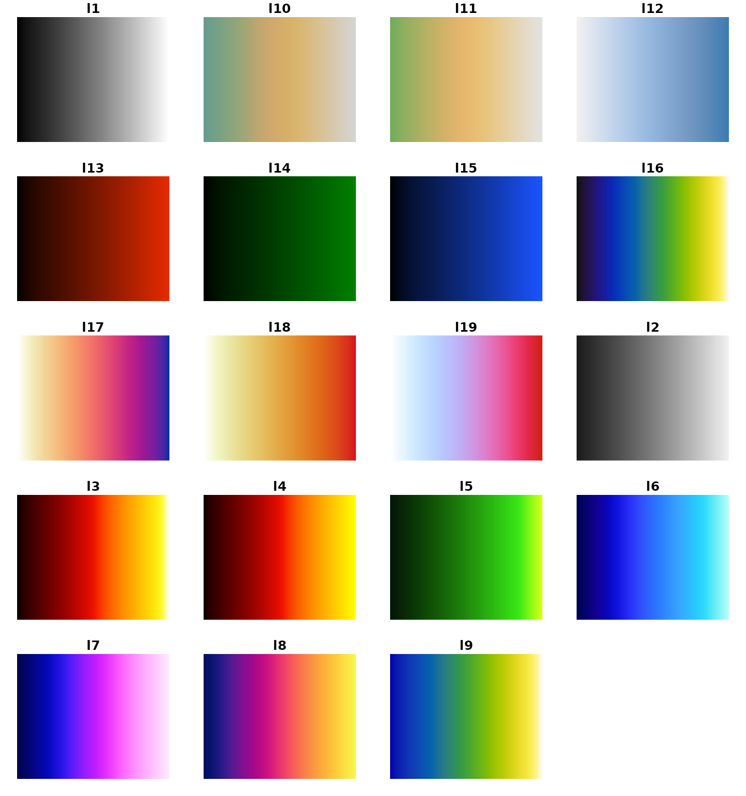
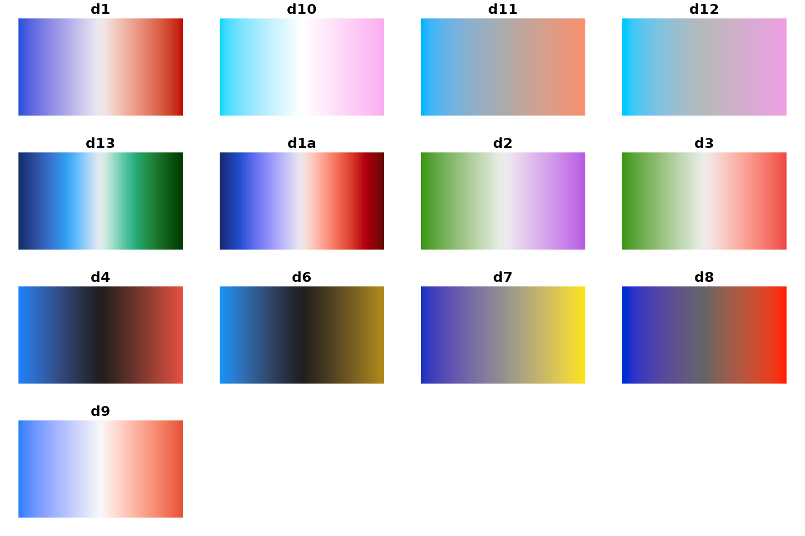
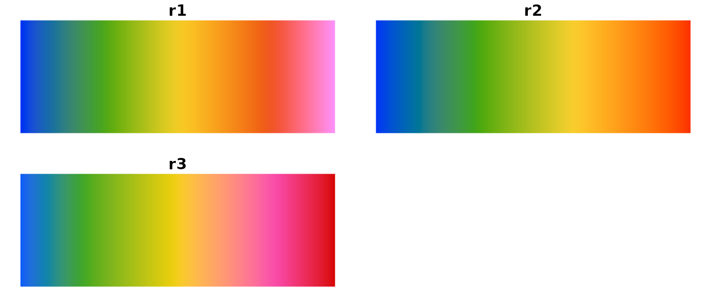
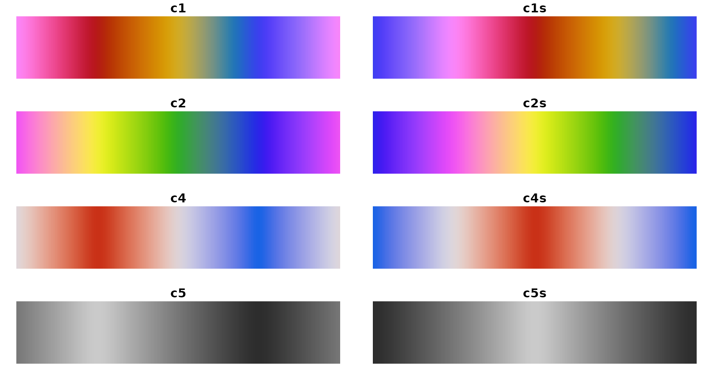
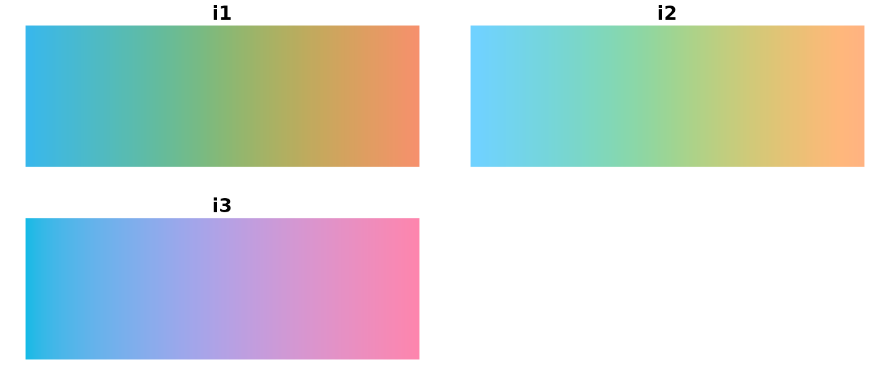
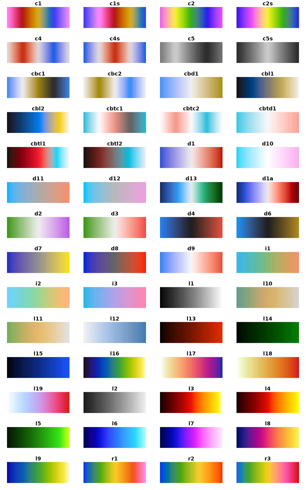

# CET Perceptually Uniform Colour Maps

The [`cetcolor`](https://cran.r-project.org/package=cetcolor) package is
designed to bring to *R* the colour maps created by [Peter
Kovesi](http://peterkovesi.com/projects/colourmaps/) in Kovesi (2015).
These colour maps avoid points of locally high colour contrast leading
to the perception of false anomalies in your data when there are none.
The colour maps have been designed to avoid this phenomenon by having
uniform perceptual contrast over their whole range.

This vignette attempts to summarize information presented at
<http://peterkovesi.com/projects/colourmaps/>.

## Supported Colour Maps

There are 56 supported colour maps organised according to the
attributes:

- Linear
- Diverging
- Rainbow
- Cyclic
- Isoluminant
- Colourblind

## Organisation of Colour Maps

The colour maps have a short name and a long name. The shortname is
meant to use while graphing and the long name is meant to understand how
the color map was generated.

The shortnames are created by having at the start one or two characters
to indicate whether the map is: linear (l), diverging (d), rainbow (r),
cyclic(c), isoluminant (i) or colour blind (cb). From there, a number is
appended to the end. For example, the linear greyscale is ‘l1’, the heat
colour map is ‘l3’, and the blue-white-red diverging map is ‘d1’ and so
on. Below, you will see each of the sections of colourmaps in a visual
catalog with their shortnames.

Each colour map is also assigned a “long” named as follows:

                        linear_kryw_5-100_c67_n256
                          /      /    |    \    \
    Colour map attribute(s)     /     |     \    Number of colour map entries
                               /      |      \
         String indicating nominal    |       Mean chroma of colour map
         hue sequence.                |
                                  Range of lightness values

Moreover, the colour map name may contain cyclic shift information as
well as indicating whether it has been reversed by a flag.

                  cyclic_wrwbw_90-40_c42_n256_s25_r
                                              /    \
                                             /   Indicates that the map is reversed.
                                            / 
                       Percentage of colour map length
                       that the map has been rotated by.

## Colour Maps

Please note, some colormaps have been “deprecated” from the initial
release. As a result, these colormaps do *not* have a shortname and,
thus, their long-name are displayed. In a future release, we will likely
remove these color schemes.

### Linear

``` r

library("cetcolor")
display_cet_attribute(attribute = "linear")
```



### Diverging

``` r

display_cet_attribute(attribute = "diverging")
```



### Rainbow

``` r

display_cet_attribute(attribute = "rainbow")
```



### Cyclic

``` r

display_cet_attribute(attribute = "cyclic")
```



### Isoluminant

``` r

display_cet_attribute(attribute = "isoluminant")
```



### Overall

``` r

display_cet_all()
```



Kovesi, Peter. 2015. “Good Colour Maps: How to Design Them.” *CoRR*
abs/1509.03700. <http://arxiv.org/abs/1509.03700>.
